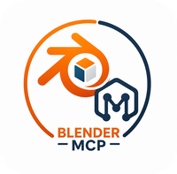
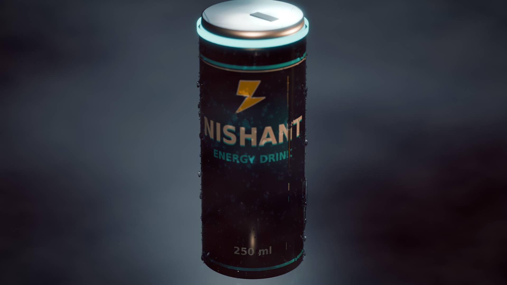
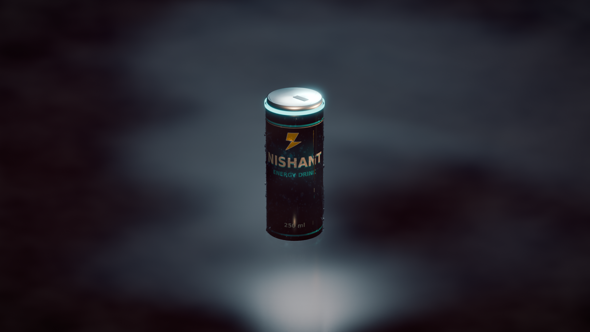
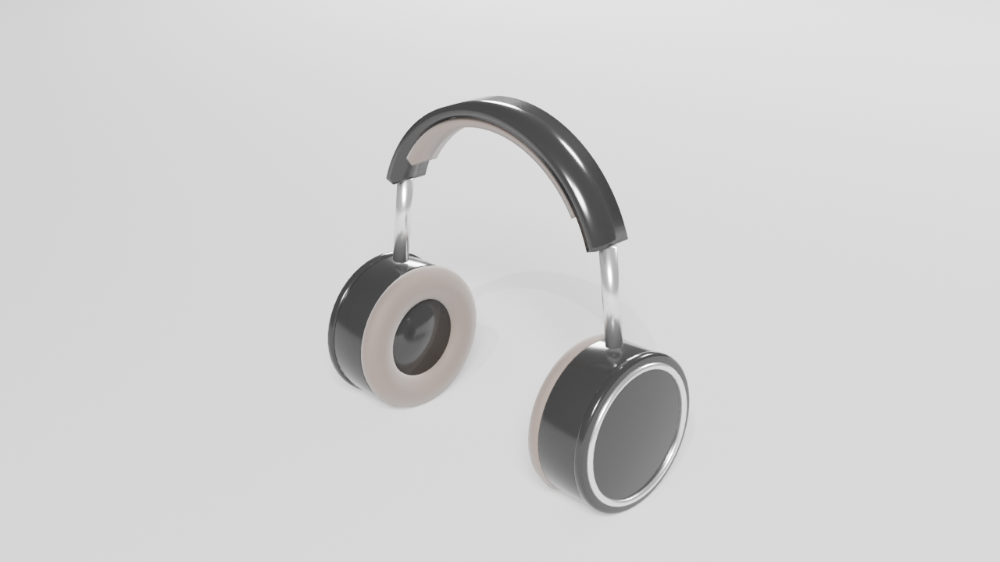
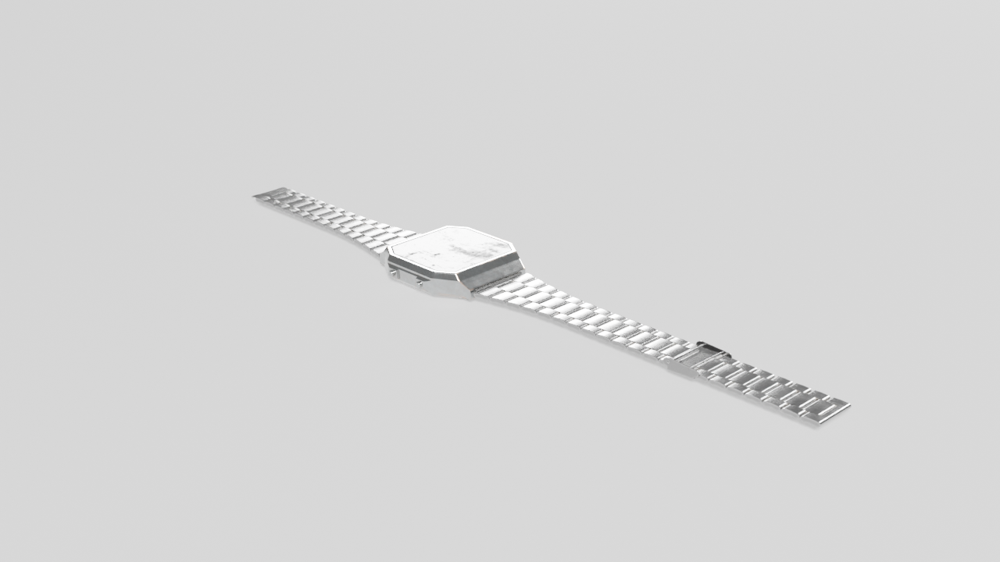
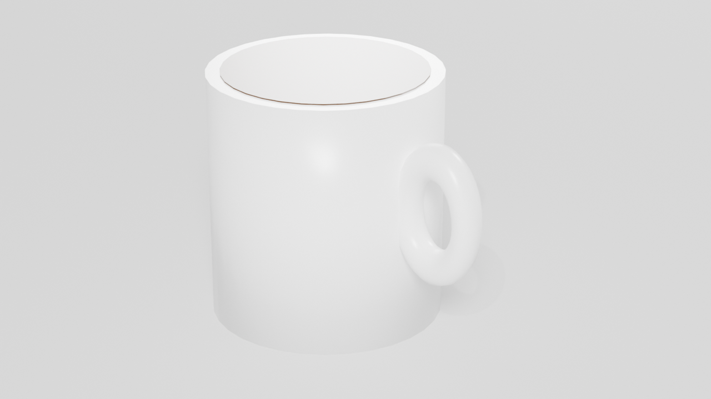
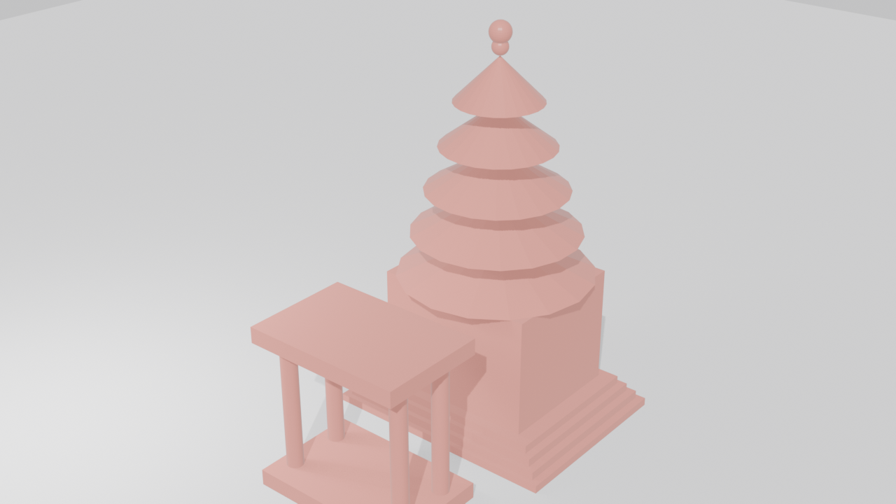
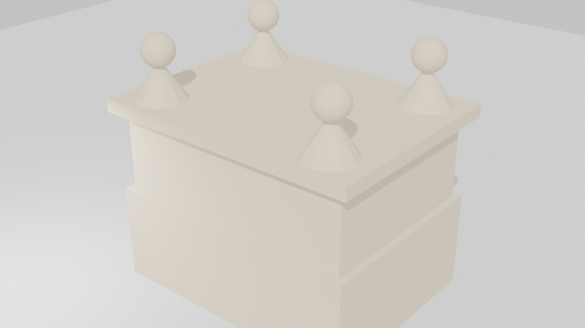

<!--
  Blender MCP Server
  Prompt or reference image in, professional product 3D model / render out.
-->
<h1 align="center">
  <br>
  
  <br>
  <br>
  Blender MCP Server
  <br>
</h1>

<p align="center">
  <strong>Give any AI model a prompt or a reference image. Get back a professional product 3D model or render — researched, dimensioned, verified, and rendered in Blender.</strong>
  <br><br>
  
  
  
  
  
  <br>
  TypeScript + Python &nbsp;·&nbsp; Claude Code · OpenCode · any MCP client
</p>

<p align="center">
  
  <br>
  <em>NISHANT energy drink — macro close-up. Built and rendered through this MCP: researched, dimensioned, verified, cinematic Cycles render. More renders in the gallery below.</em>
</p>

---

## What it does

Blender MCP lets an AI assistant drive Blender 4.2 through the Model Context Protocol. The user describes a product — or shows a reference photo — and the agent:

1. **Researches** it first (real references, real dimensions — never guessed).
2. **Builds** it from a validated spec, or generates it with AI, or retrieves a real model.
3. **Verifies** the finished model against the spec before reporting success.
4. **Renders** it as a studio or cinematic product shot.

The guardrails live in the MCP server, enforced in code — so **any** AI model connected to it produces the same grounded, verified result. No model can silently hallucinate a model, skip the research, or report success on a broken build.

---

## Gallery — built and rendered through this MCP

Every image below was produced by driving this MCP server (research → grounded build → verification → render). No stock photos, no hand-made Blender scenes.

<table>
<tr>
<td width="50%">


**NISHANT energy drink — macro close-up.** The best cinematic shot: the can fills 85% of the frame, glowing cyan neck ring, bimodal condensation droplets, legible label. 1920×1080, Cycles, 128 samples + OIDN, `style: "cinematic"`, dark studio.

</td>
<td width="50%">


**NISHANT energy drink — dark-studio hero.** Full can, dark teal fog, wet-floor key pool, glowing ring. 1920×1080, Cycles, 128 samples + OIDN, cinematic preset. The can sits slightly small in frame — the close-up above is the stronger shot.

</td>
</tr>
<tr>
<td width="50%">


**NOIR perfume.** Bevelled glass body, amber liquid, gold neck ring, seated gold cap, white label. Built with real curves, not stacked boxes. 1280×720, Cycles.

</td>
<td width="50%">


**Over-ear headphones.** Arched swept band with inner cushion, padded torus cup cushions, steel yokes, metal-ringed cups. 1280×720, Cycles.

</td>
</tr>
<tr>
<td width="50%">


**Steel digital watch — a real model, retrieved.** Poly Haven `digital_wrist_watch` (CC0), fetched by `retrieve_asset` instead of modelling from primitives: link bracelet, clasp, octagonal case. 1280×720, Cycles.

</td>
<td width="50%">


**Coffee mug — the grounded-build demo.** Research refused a build with no grounding, then a researched + verified build (20/20 checks) rendered with dark-brown coffee and a proper loop handle. 1280×720.

</td>
</tr>
<tr>
<td width="50%">


**Indian temple.** The template library: Z-up, metre-scale, every part standing on the ground. 1280×720.

</td>
<td width="50%">


**Haveli.** Research-dimensioned rebuild: open courtyard, two floors, arched windows, chhatri domes, sandstone + fresco band. 1280×720.

</td>
</tr>
</table>

---

## How it works

```
prompt / reference image
      │  research_model  →  references + part breakdown + grounding record
      ▼
  get_dimensions (real-world dimension library, 16 products)
      │  build_from_spec / build_product / generate_3d / retrieve_asset
      ▼  post-build verification (re-opens the .blend, checks every part)
  render_model  →  studio or cinematic PNGs, verified to exist
      │  critique_model (render → critique → fix → re-render, max 3 rounds)
      ▼
  verified model + render
```

### End-to-end example — a coffee mug, through the MCP

```text
research_model("coffee mug")
  → grounding grd_… , 5 real references

get_dimensions("coffee_mug")
  → [0.111, 0.082, 0.088] m, sourced

build_from_spec(spec, grounding)
  → built, 20/20 verification checks passed, min z = 0

render_model(blend, engine="CYCLES", style="cinematic")
  → coffee-mug.png (verified on disk, non-empty)
```

A build with no grounding is refused outright:

```text
build_from_spec(spec)          # no research_model call first
  → error: call research_model first — no silent fallback, no best guess
```

---

## Features

| Feature | What it means in practice |
|---|---|
| **Research-first, enforced (v1.3.1)** | `build_from_spec` refuses any build without a grounding record (research, reference image, retrieved asset, or dimension library). Fabricated grounding IDs are refused. |
| **Strict spec validation** | Every part needs `dimension_source` + `material`. Missing / zero / negative / placeholder dimensions, floating parts, z &lt; 0, and parts outside the 10 m work area are rejected with the exact failed check. Library claims must match `get_dimensions` within 10%. |
| **Post-build verification** | The saved `.blend` is re-opened and checked (part presence/count, min z ≥ 0, every part has a material, dimensions vs spec, connectivity, observed reference features) before success is reported. A bad build reports `success:false`, never `success:true`. |
| **Real-world dimension library** | `get_dimensions` — researched dimensions for 16 products (headphones, sneaker, perfume, smartwatch, chair, temple, rickshaw, thali, haveli, character, spaceship, alien, robot, coffee_mug, desk_lamp, slim_can_250ml), each with its source. |
| **AI generation (v1.3.0)** | `generate_3d` — text-to-3D and image-to-3D via Meshy (first) and Tripo. Keys from env vars only; no key → the tool says so honestly and points at the free local path. |
| **Real assets first** | `retrieve_asset` searches Poly Haven (CC0, no key) and downloads the model before anything is modelled from primitives. |
| **Reference-image input** | `research_model` accepts a reference image (local path or URL). With a generation key it drives image-to-3D; without one it is the visual reference the spec is built from, and the post-build check confirms the observed features exist. |
| **Cinematic render preset (v1.4.0)** | `render_model` with `style: "cinematic"` — low-key 8:1 lighting, warm key + teal rim, volumetric fog, wet reflective floor, AgX Punchy, depth of field, and a full compositor chain (glare/bloom, colour grade, vignette, film grain). Environments: `dark_studio`, `industrial_hall`, `neon`. `style: "studio"` keeps the previous presentation preset. |
| **Vision critique loop** | `critique_model` renders 5 views, runs programmatic checks, and returns a structured critique prompt (per-spec-item pass/fail, problem→fix pairs) for the calling model. Max 3 auto-refine rounds, keep-best + revert. |
| **Detail helpers** | `add_detail` — bevels, subdivision, panel lines, screws, bolts, seams, grilles/vents, labels, condensation droplets, emissive rings. |
| **Product builders** | `build_product` — headphones, sneaker, perfume, smartwatch, and more, built with real curves (lathe/loft/sweep), not stacked primitives. |

---

## Tools

All 17 tools, identical in the TypeScript and Python servers:

| Tool | What it does |
|---|---|
| `research_model` | Research-first step. Searches references, returns the part-breakdown schema **and a grounding record**. Accepts `reference_image`. No code is written before this step. |
| `get_dimensions` | Real-world dimensions for a product (overall + per-part, metres, with sources). Omit the argument to list all products. |
| `build_from_spec` | Build a scene from a validated JSON scene spec (metres, Z-up, bottom-centre positions, mate attachments). Requires grounding; verified after the build. |
| `generate_3d` | AI text-to-3D / image-to-3D (Meshy first, Tripo second). Needs `MESHY_API_KEY` / `TRIPO_API_KEY`. Downloads the GLB immediately, imports and normalises it (min z = 0). |
| `retrieve_asset` | Search Poly Haven (CC0, no key) and download a real model before modelling from primitives. Poly Pizza needs `POLY_PIZZA_API_KEY`. |
| `build_product` | Build a catalogue product with real curves (headphones, sneaker, perfume, smartwatch). `source: auto` prefers a retrieved real asset. |
| `add_detail` | Apply a named detail to an object of a saved `.blend`: `bevel`, `subdivision`, `panel_line`, `screw`, `bolt`, `seam`, `grille`, `label`, `condensation`, `emissive_ring`. |
| `critique_model` | Vision critique loop: 5 views + programmatic checks + structured critique prompt for the calling model. |
| `render_model` | Render a saved `.blend` as verified PNGs. EEVEE (default, fast) or Cycles (finals, + OIDN). `style: "cinematic"` for the hero preset, `style: "studio"` for the presentation preset. Exact fill-based framing, turntable frames, transparent-background shots. |
| `create_complex_model` | Build complex models with search + detailed planning (Indian themes: temples, vehicles, food, characters, buildings). |
| `execute_blender_code` | Run arbitrary Blender Python (`bpy`). Ungrounded code is returned with an explicit `UNVERIFIED` warning. |
| `modify_model` | Modify an existing model — colours, materials, scale, rotation, effects. |
| `apply_texture` | Procedural Principled BSDF materials (wood, marble, metal, fabric, steel, glass, skin, sandstone) or a real Poly Haven texture via `polyhaven:<slug>` (colour-space-correct, packed into the `.blend`). |
| `search_models` | Search the internet for 3D models across multiple sources. |
| `search_textures` | Search free texture databases. |
| `get_scene_info` | Inspect the current Blender scene. |
| `import_from_url` | Import a 3D model from a URL (GLB / OBJ / STL / FBX …), normalised to 1 m longest side, on the ground. |

---

## Quickstart

**Requirements:** Node.js 18+, Blender 4.2.

```bash
# From source (latest, v1.4.0)
git clone https://github.com/IamNishant51/Blender-MCP.git
cd Blender-MCP
npm install
npm run build

# Or install the published package
npm install -g blender-mcp
```

### Claude Code

Add to `~/.claude.json` (from source):

```json
{
  "mcpServers": {
    "blender": {
      "command": "node",
      "args": ["/path/to/Blender-MCP/dist/index.js"]
    }
  }
}
```

Or with the published package:

```json
{
  "mcpServers": {
    "blender": { "command": "npx", "args": ["blender-mcp"] }
  }
}
```

### OpenCode / other MCP clients

```json
{ "blender": "npx blender-mcp" }
```

```bash
# Or run directly
npx blender-mcp
node dist/index.js
```

### Environment variables

| Variable | Default | Description |
|---|---|---|
| `BLENDER_EXECUTABLE` | `blender` | Path to the Blender executable |
| `BLENDER_TIMEOUT` | `120` | Timeout for Blender operations (seconds). Render calls raise their own floor (Cycles 1800 s, EEVEE 600 s); raise it for long cinematic renders, e.g. `BLENDER_TIMEOUT=3600`. |
| `BLENDER_MCP_DIR` | `~/Desktop/BLENDER-MCP` | Base directory for outputs |
| `BLENDER_MCP_DEBUG` | `false` | Enable debug logging |
| `MESHY_API_KEY` | — | Meshy key for `generate_3d`. No key = honest message, free local path instead. Never put a key in source. |
| `TRIPO_API_KEY` | — | Tripo key for `generate_3d` (second provider). Same no-key behaviour. |
| `POLY_PIZZA_API_KEY` | — | Poly Pizza key for `retrieve_asset`. Search returns HTTP 401 without one; the tool says so and searches Poly Haven instead. |

---

## What's new

### v1.4.0 — cinematic hero renders

- `render_model` gains `style: "cinematic"`: low-key 8:1 lighting (warm key + teal rim at 2× key), bounded volumetric fog, wet reflective floor, AgX Punchy, depth of field, and a full compositor chain (Mist → Glare Fog Glow → Colour Balance → RGB Curves → vignette → film grain). Environments: `dark_studio`, `industrial_hall`, `neon`. Optional `scale_figure` (1.7 m human silhouette) and `hero_scale_m` for monumental shots.
- New materials: `roughness_variation`, `weathered_stone`, `brushed_aluminium`, `printed_can` (paint over aluminium — metallic belongs only on unprinted metal), `wet_floor`, `emissive_ring` / `glow_strip`, `condensation`. New dimension entry `slim_can_250ml` (Crown 202 × 504.5, Ø 53 × 133 mm).
- Critique loop gains seven cinematic checks (hero brightest? rim visible? shafts vs readability? shadows hold detail? figure human-sized? thirds? banding?).
- Demo: the NISHANT energy drink (gallery above) — researched, grounded, lathe-built, verified 26/26, rendered 1920×1080, Cycles, 128 samples + OIDN.
- Fixes: the coffee material silently fell back to flat grey and the coffee disc z-fought with the body cap — both fixed, mug re-rendered with dark-brown coffee; flat caps stay flat-shaded; the cinematic vignette is now built at full render resolution (it used to crop every cinematic frame to a centred 256×256 square).

### v1.3.1 — anti-hallucination guarantees

Research-first gate, strict spec validation, `get_dimensions` library, reference grounding, post-build verification before any success is reported, guardrail tool descriptions. See [Features](#features).

### v1.3.0 — product realism

`generate_3d` (Meshy/Tripo), reference-image input, Cycles studio pipeline (HDRI, 3-point + rim rig, PBR maps, turntable, transparent-background shots), `add_detail` helpers, `critique_model`, `retrieve_asset`, `build_product` with real curves, exact fill-based camera framing.

### v1.2.0 — research-first pipeline

`research_model` + `build_from_spec` + `render_model` with render verification, materials v2 (procedural node trees, Poly Haven textures), and research-dimensioned fixes for the rickshaw, thali, haveli, and character templates.

### v1.1.0 — the axis fix

All five templates rewritten Z-up in metres, temple default removed, `execute_blender_code`, working `import_from_url`, logs to stderr, real tests.

---

## Development

```bash
npm install
npm run build     # tsc
npm test          # build + TS template checks
npm start         # node dist/index.js

# Python tests (needs Blender 4.2)
BLENDER_EXECUTABLE=/path/to/blender pytest tests/ -q
```

The test suite runs against real Blender 4.2.0: geometry/bounding-box tests for every template, grounding-gate tests (no-research refusal, fabricated grounding refusal, invented-dimension rejection, floating-part rejection, bad-build failure reporting), cinematic-preset tests, and render-existence checks. `tests/verify_blender.py` runs the Blender-side checks directly.

### Architecture

```
+-----------+      MCP      +-------------+    subprocess   +---------+
| Claude /  |  <----------> | blender-mcp |  --background   | Blender |
| Copilot / |               | (Node.js /  |  --python       | 4.2.0   |
| any agent |               |  Python)    |                 | --bg    |
+-----------+               +-------------+                 +---------+
```

Blender runs headless as a background subprocess; each tool call executes a generated Python script through `bpy`, and the result is verified (files exist, `.blend` re-opened and checked) before success is reported. Logs go to stderr so the MCP stream on stdout stays clean.

---

## Honest limits

- **No AI-generated meshes without a key.** The free local path builds from primitives + details + real textures + studio/cinematic rendering. That is visibly better than v1.2.0, but it cannot match a human 3D artist's mesh. The realistic leap needs `generate_3d` with a Meshy/Tripo key, or a retrieved real asset.
- **The MCP itself cannot see images.** `critique_model` renders and checks programmatically; the visual judgement is the calling model's job.
- **Cycles on CPU is slow.** A 128-sample 1920×1080 cinematic frame (fog + DoF + condensation) takes ~35–50 minutes on a 4-core CPU-only machine. EEVEE previews stay the fast path. On headless Linux, EEVEE needs `libEGL.so.1` (`libegl1`); Cycles CPU rendering does not.
- **The studio preset washes dark horizontal surfaces.** Dark products should be judged on cinematic renders, not studio ones.
- **Python server (known issue):** the Python implementation mirrors all 17 tools, but it currently fails to start against the installed MCP SDK version (old `list_tools_handler` / `call_tool_handler` API). The TypeScript server is the supported path until the Python server is migrated.
- **`node_modules`, `dist`, and `__pycache__` are committed in git history.** They are gitignored going forward; cleaning history is a separate task.

---

## Contributing

Issues and pull requests are welcome. Please run `npm test` and the Python suite (`pytest tests/ -q` with Blender 4.2) before submitting, and keep the anti-hallucination gates intact: no new build path may bypass the grounding requirement or the post-build verification.

---

## License

MIT License — see [LICENSE](LICENSE).

---

🌐 **Author:** [Nishant Unavane](https://github.com/IamNishant51) — [nishantunavane.qzz.io](https://nishantunavane.qzz.io)
